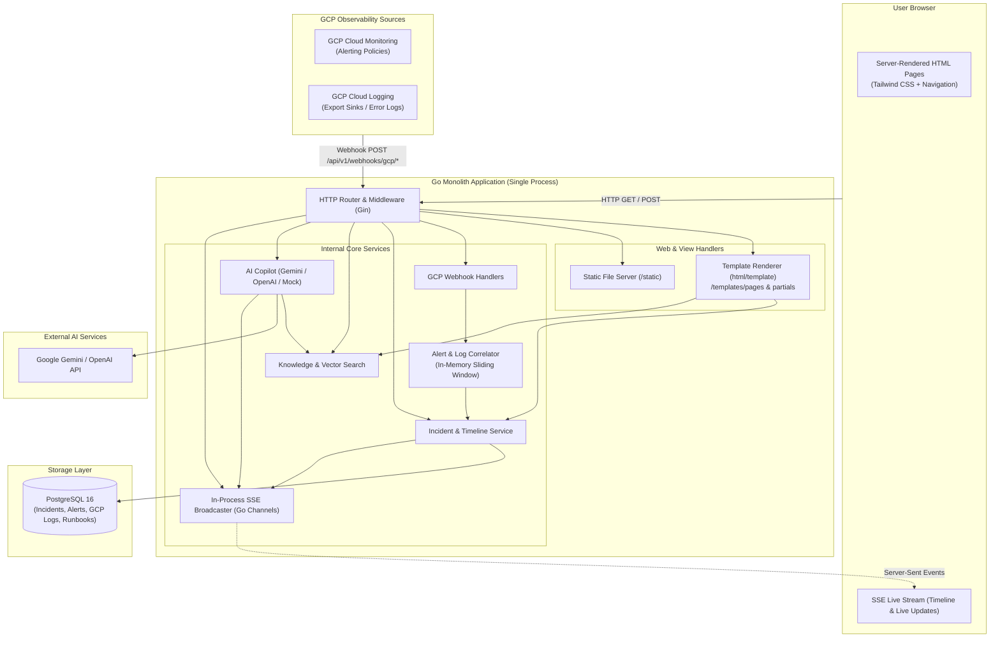
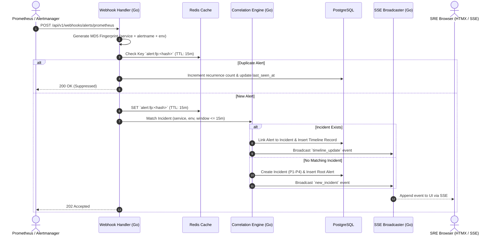

# High-Level System Design (HLD)
## SRE Copilot: Monolithic Architecture & System Topology

- **Document Version:** 1.1.0
- **Status:** Approved / Architecture Ready
- **Architecture Style:** Pure Go Monolith (`html/template` + Gin / Net/HTTP)
- **Target Tech Stack:** Go, PostgreSQL 16 + pgvector, Tailwind CSS, HTMX, Google Cloud Monitoring & Logging

---

## 1. Monolithic System Architecture Overview

SRE Copilot is designed as a unified Go monolith. All layers—HTTP routing, template rendering, GCP webhook ingestion, correlation logic, database persistence, and AI orchestration—execute in a single runtime process. No external Redis cache is required.



---

## 2. Directory Layout & Package Structure

The monolithic codebase adheres to standard Go project conventions:

```
d:/SRE-Copilot/
├── cmd/
│   └── server/
│       └── main.go                 # App entry point, config bootstrap, server start
├── internal/
│   ├── config/                     # Env config (DB credentials, API keys, ports)
│   ├── database/                   # Postgres (pgxpool + pgvector) and Redis connections
│   ├── models/                     # Go structs (Incident, Alert, Timeline, Runbook, RCA)
│   ├── repository/                 # Database queries, CRUD, and pgvector cosine queries
│   ├── services/
│   │   ├── alert_correlator.go     # Sliding window & fingerprint deduplication
│   │   ├── incident_service.go     # State transitions, severity, timeline logs
│   │   ├── ai_copilot.go           # Prompt assembly, RAG context, streaming LLM caller
│   │   └── knowledge_service.go    # Document chunking, embedding, and vector search
│   └── handlers/
│       ├── web_handlers.go         # Serves HTML pages using html/template
│       ├── api_handlers.go         # REST endpoints for interactive operations
│       ├── webhook_handlers.go     # Prometheus/Grafana alert webhook receivers
│       └── sse_handlers.go         # Server-Sent Events broker for real-time streaming
├── templates/                      # Go html/template views
│   ├── layouts/
│   │   └── base.html               # Master shell, navbar, theme, HTMX scripts
│   ├── partials/                   # Reusable components
│   │   ├── incident_card.html      # Triage card
│   │   ├── timeline_item.html      # Event item for live append
│   │   ├── alert_badge.html        # Firing/resolved badge
│   │   └── copilot_message.html    # AI chat bubbles (user & assistant)
│   └── pages/                      # Full-page views
│       ├── dashboard.html          # Active incidents, triage feed, metrics
│       ├── incident_detail.html    # Dual-pane investigation workspace
│       ├── knowledge.html          # Runbook & postmortem search
│       └── rca_editor.html         # Postmortem generator & action items
├── static/                         # Static assets served directly by Go
│   ├── css/                        # Tailwind CSS builds / overrides
│   ├── js/                         # HTMX, Alpine.js, SSE client helpers
│   └── img/                        # Icons and branding SVGs
├── go.mod
├── go.sum
└── README.md
```

---

## 3. Frontend Technology & Rendering Strategy

Instead of a bulky Node.js or Single-Page Application (SPA) architecture, the frontend uses modern **HTML-over-the-Wire**:
1. **Go `html/template`:**
   - Compiled and parsed at application startup (or reloaded dynamically in dev mode).
   - Fast, memory-efficient, safe against XSS by default.
2. **Tailwind CSS:**
   - Utility-first CSS classes providing a clean SRE operational dashboard aesthetic.
3. **HTMX + Server-Sent Events (SSE):**
   - **Live Incident Timeline:** HTMX listens to the SSE stream `/api/v1/incidents/:id/sse` and appends incoming alerts and status changes to the DOM without full-page reloads.
   - **Streaming AI Copilot Chat:** Uses lightweight streaming via standard browser `EventSource` / `fetch` readable streams to render AI responses word-by-word as generated by Gemini or OpenAI.

---

## 4. Ingestion & Correlation Workflow



---

## 5. AI Copilot RAG Flow (Within Monolith)

1. SRE clicks **"Ask Copilot"** or requests triage on `incident_detail.html`.
2. The Go handler `POST /api/v1/incidents/:id/ai/chat` loads:
   - Incident metadata (service, environment, severity, started_at).
   - Correlated alerts and timeline events from PostgreSQL.
   - Embeds query and queries `knowledge_documents` using `pgvector` for top-3 relevant runbooks / historical incidents.
3. Assembles prompt and calls LLM (Gemini / OpenAI) via streaming API.
4. Chunks are piped directly over the HTTP response stream (`text/event-stream`), rendering token-by-token in the investigation panel.
